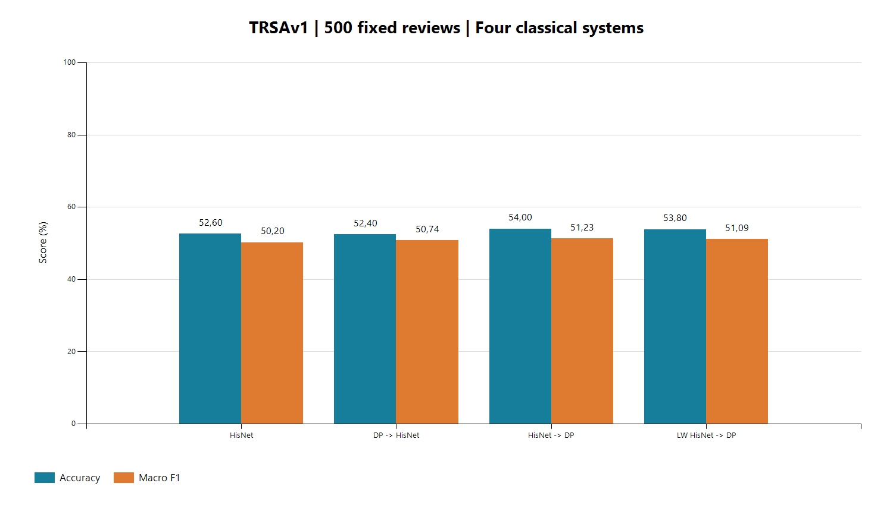
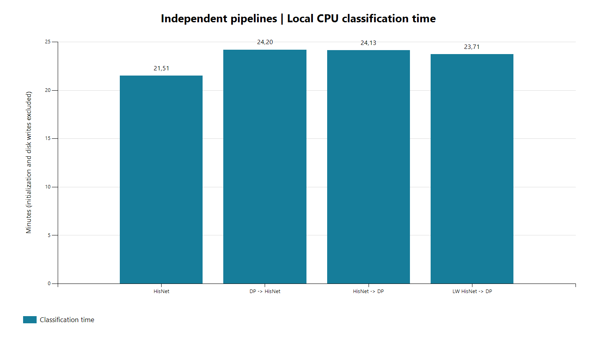

# TRSAv1 — dört klasik sistem, sabit 500 yorum

Koşu tamamlandı: **True**. Eksik koşudaki metrikler yalnız başarılı altküme içindir.

Bu koşu geliştirme/teşhis amaçlıdır. Önceden kullanılan 500 örnek aynen korunmuştur; bağımsız final test seti değildir. HisNet maddeleri, fiil kökü eşleştirmesi, morfoloji kuralları, eşik ve LW katsayıları bu koşu için değiştirilmedi.

## Örneklem ve çalışma protokolü

Kaynak: 125561 temizlenmiş TRSAv1 satırı. Örneklem: {'negative': 167, 'neutral': 166, 'positive': 167}. Seed 42 stratified örneklemiyle eşleşme: True.

Protokol: her sistem aynı 500 yorumu aynı sırayla, bağımsız pipeline üzerinden işler. Başka sistemin hazır HisNet sonucu kullanılmadı. Her satır SQLite'a kaydedildi; tam ara çıktılar attempts tablosunda duruyor. LLM kullanılmadı.

Kaynak veride farklı etiketle de bulunan örnekler: [59, 101, 163, 208, 239, 357, 371, 480]. Bu satırlar ana ölçümde korunmuştur; aşağıda çıkarıldıklarındaki sonuç ayrıca verilir.

## Genel performans

| Sistem | Doğru/n | Accuracy % | Macro P % | Macro R % | Macro F1 % | Weighted F1 % | Accuracy %95 aralık |
| --- | --- | --- | --- | --- | --- | --- | --- |
| HisNet | 263/500 | 52.60 | 50.40 | 52.54 | 50.20 | 50.24 | 48.22–56.94 |
| DP → HisNet | 262/500 | 52.40 | 50.69 | 52.35 | 50.74 | 50.78 | 48.02–56.74 |
| HisNet → DP | 270/500 | 54.00 | 51.27 | 53.93 | 51.23 | 51.27 | 49.62–58.32 |
| LW HisNet → DP | 269/500 | 53.80 | 51.00 | 53.73 | 51.09 | 51.13 | 49.42–58.12 |

Aralıklar Wilson yaklaşımıyla hesaplanan yaklaşık örneklem belirsizliğidir; etiket hatalarını veya yeniden kullanılan geliştirme setindeki iyimserliği kapsamaz. Dengeli örneklemde çoğunluk sınıfı tabanı 167/500 = %33,40.

## Sınıf bazında precision / recall / F1

| Sistem | Sınıf | n | Precision % | Recall % | F1 % |
| --- | --- | --- | --- | --- | --- |
| HisNet | negative | 167 | 58.38 | 68.86 | 63.19 |
| HisNet | neutral | 166 | 40.22 | 22.29 | 28.68 |
| HisNet | positive | 167 | 52.61 | 66.47 | 58.73 |
| DP → HisNet | negative | 167 | 59.88 | 61.68 | 60.77 |
| DP → HisNet | neutral | 166 | 38.74 | 25.90 | 31.05 |
| DP → HisNet | positive | 167 | 53.46 | 69.46 | 60.42 |
| HisNet → DP | negative | 167 | 59.50 | 71.26 | 64.85 |
| HisNet → DP | neutral | 166 | 39.33 | 21.08 | 27.45 |
| HisNet → DP | positive | 167 | 54.98 | 69.46 | 61.38 |
| LW HisNet → DP | negative | 167 | 59.30 | 70.66 | 64.48 |
| LW HisNet → DP | neutral | 166 | 38.46 | 21.08 | 27.24 |
| LW HisNet → DP | positive | 167 | 55.24 | 69.46 | 61.54 |

## Karışıklık matrisleri

Satırlar gerçek etiket, sütunlar tahmin. Her sistemin tüm örnekleri başarıyla tamamlanmadıysa matris yalnız başarılı altkümeyi içerir.

### HisNet

| Gerçek / tahmin | negative | neutral | positive |
| --- | --- | --- | --- |
| negative | 115 | 29 | 23 |
| neutral | 52 | 37 | 77 |
| positive | 30 | 26 | 111 |

### DP → HisNet

| Gerçek / tahmin | negative | neutral | positive |
| --- | --- | --- | --- |
| negative | 103 | 41 | 23 |
| neutral | 45 | 43 | 78 |
| positive | 24 | 27 | 116 |

### HisNet → DP

| Gerçek / tahmin | negative | neutral | positive |
| --- | --- | --- | --- |
| negative | 119 | 30 | 18 |
| neutral | 54 | 35 | 77 |
| positive | 27 | 24 | 116 |

### LW HisNet → DP

| Gerçek / tahmin | negative | neutral | positive |
| --- | --- | --- | --- |
| negative | 118 | 30 | 19 |
| neutral | 56 | 35 | 75 |
| positive | 25 | 26 | 116 |

## İkili farklar

İyileşen: ilk sistem yanlışken ikinci doğru. Bozulan: ilk sistem doğruyken ikinci yanlış. Test, yalnız doğru/yanlış değişen eşleşmelerde iki yönlü exact binom testidir (exact McNemar); Holm düzeltmesi altı karşılaştırmaya uygulanır. Bunlar keşifsel ölçümlerdir. Hesaplama: [SciPy binomtest](https://docs.scipy.org/doc/scipy/reference/generated/scipy.stats.binomtest.html).

| İlk sistem | İkinci sistem | Tahmini değişen | İyileşen | Bozulan | Net doğru | p | Holm p |
| --- | --- | --- | --- | --- | --- | --- | --- |
| HisNet | DP → HisNet | 76 | 28 | 29 | -1 | 1.0000 | 1.0000 |
| HisNet | HisNet → DP | 24 | 12 | 5 | 7 | 0.1435 | 0.8608 |
| HisNet | LW HisNet → DP | 41 | 16 | 10 | 6 | 0.3269 | 1.0000 |
| DP → HisNet | HisNet → DP | 57 | 26 | 18 | 8 | 0.2912 | 1.0000 |
| DP → HisNet | LW HisNet → DP | 61 | 26 | 19 | 7 | 0.3713 | 1.0000 |
| HisNet → DP | LW HisNet → DP | 17 | 4 | 5 | -1 | 1.0000 | 1.0000 |

Dördünün birlikte doğru olduğu yorum: **231**; birlikte yanlış: **205**; sistemlerin farklı etiket verdiği yorum: **86**.

## Süreler

| Sistem | Başlatma s | Sınıflandırma s | Ortalama ms/yorum | Medyan ms | P95 ms |
| --- | --- | --- | --- | --- | --- |
| HisNet | 4.80 | 1290.38 | 2580.76 | 20.30 | 11447.06 |
| DP → HisNet | 17.55 | 1451.86 | 2903.73 | 342.38 | 11490.02 |
| HisNet → DP | 3.01 | 1447.87 | 2895.74 | 310.74 | 11832.08 |
| LW HisNet → DP | 2.30 | 1422.43 | 2844.86 | 308.62 | 11872.98 |

Süreler yerel CPU, önbellek ve o anki sistem yüküne bağlıdır. Başlatma ayrıca gösterilir; kayıt/dışa aktarma beklemeleri sınıflandırma süresine dahil değildir. Toplam süre tüm kaydedilmiş girişimleri kapsar; yorum başına dağılımlar son girişimden alınır. Kesilen/cevabı kaydedilmeyen girişimlerin süresi bilinmez. Sistemler sıralı çalışır; kontrollü donanım benchmark'ı değildir.

### Morfolojik çözümleme türüne göre süre

| Sistem | Grup | Yorum | Toplam s | Ortalama ms | Medyan ms |
| --- | --- | --- | --- | --- | --- |
| HisNet | robust_or_fallback_present | 186 | 1285.49 | 6911.22 | 4148.74 |
| HisNet | normal_only | 314 | 4.89 | 15.58 | 10.37 |
| DP → HisNet | robust_or_fallback_present | 186 | 1362.97 | 7327.77 | 4616.77 |
| DP → HisNet | normal_only | 314 | 88.90 | 283.12 | 245.14 |
| HisNet → DP | robust_or_fallback_present | 186 | 1365.49 | 7341.35 | 4530.00 |
| HisNet → DP | normal_only | 314 | 82.38 | 262.36 | 229.62 |
| LW HisNet → DP | robust_or_fallback_present | 186 | 1341.63 | 7213.06 | 4440.41 |
| LW HisNet → DP | normal_only | 314 | 80.80 | 257.33 | 223.66 |

Gruplar kaydedilmiş analysis_source alanına göre belirlenir. Robust/fallback içeren yorumlar daha uzun veya yazım hatalı da olabilir; bu gruplama tek başına nedensel hız ölçümü değildir. Mevcut morfoloji kodu her yeni OOV için izole çözümleyici kurar ve adayları önbelleğe alır; bu davranış deney sırasında değiştirilmedi.

## Kapsam ve işlem tanıları

| Sistem | Skoru 0/0 yorum | Bunlardan polar etiketli | Duygu sözcüğü olmayan |
| --- | --- | --- | --- |
| HisNet | 64 | 41 | 64 |
| DP → HisNet | 97 | 64 | 97 |
| HisNet → DP | 64 | 41 | 64 |
| LW HisNet → DP | 65 | 41 | 64 |

0/0; sözlük kapsamı, morfoloji veya dependency aday seçimi gibi farklı nedenlerden doğabilir. Tek başına kod hatası kanıtı değildir.

| Sistem | Olumsuzluk çevirme | Hedef bastırma | Eşleşmeyen kapsam | LW modifier | LW contrast |
| --- | --- | --- | --- | --- | --- |
| HisNet | 0 | 0 | 0 | 0 | 0 |
| DP → HisNet | 37 | 5 | 0 | 0 | 0 |
| HisNet → DP | 44 | 42 | 0 | 0 | 0 |
| LW HisNet → DP | 44 | 42 | 0 | 124 | 272 |

Sayılar yorum sayısı değil kapsam/işlem sayısıdır. LW ayrıca modifier bileşeni ve contrast marker bastırması yapabilir; fark yalnız katsayıların etkisi olarak yorumlanmamalıdır.

## Otomatik kod tutarlılığı kontrolleri

İhlal sayısı: **0**. Kontroller: sonlu/negatif olmayan skorlar, kapsam toplamları, eşik–etiket uyumu, H→DP/LW başlangıç HisNet skorlarının korunması, LW temel DP skorları, bağımsız HisNet morfoloji çıktılarının tutarlılığı, tekrarlanan token/olumsuzluk ID'leri ve cümleler arası olumsuzluk taşması. Sıfır ihlal bütün dilsel kapsam kararlarının doğru olduğunu kanıtlamaz.

## Etiket çelişkisine duyarlılık ve uzunluk dilimleri

| Sistem | Alt küme | n | Accuracy % | Macro F1 % |
| --- | --- | --- | --- | --- |
| HisNet | source_label_unambiguous | 492 | 53.05 | 50.63 |
| HisNet | source_label_conflicting | 8 | 25.00 | 19.05 |
| HisNet | 1_to_5_words | 108 | 53.70 | 52.61 |
| HisNet | 6_to_15_words | 286 | 52.80 | 49.22 |
| HisNet | 16_plus_words | 106 | 50.94 | 46.68 |
| HisNet | zero_sentiment_score | 64 | 35.94 | 17.62 |
| DP → HisNet | source_label_unambiguous | 492 | 52.85 | 51.20 |
| DP → HisNet | source_label_conflicting | 8 | 25.00 | 19.05 |
| DP → HisNet | 1_to_5_words | 108 | 50.93 | 50.51 |
| DP → HisNet | 6_to_15_words | 286 | 53.15 | 50.65 |
| DP → HisNet | 16_plus_words | 106 | 51.89 | 47.01 |
| DP → HisNet | zero_sentiment_score | 97 | 34.02 | 16.92 |
| HisNet → DP | source_label_unambiguous | 492 | 54.47 | 51.67 |
| HisNet → DP | source_label_conflicting | 8 | 25.00 | 19.05 |
| HisNet → DP | 1_to_5_words | 108 | 55.56 | 54.19 |
| HisNet → DP | 6_to_15_words | 286 | 54.90 | 51.05 |
| HisNet → DP | 16_plus_words | 106 | 50.00 | 44.73 |
| HisNet → DP | zero_sentiment_score | 64 | 35.94 | 17.62 |
| LW HisNet → DP | source_label_unambiguous | 492 | 54.27 | 51.53 |
| LW HisNet → DP | source_label_conflicting | 8 | 25.00 | 19.05 |
| LW HisNet → DP | 1_to_5_words | 108 | 55.56 | 54.19 |
| LW HisNet → DP | 6_to_15_words | 286 | 54.55 | 50.98 |
| LW HisNet → DP | 16_plus_words | 106 | 50.00 | 44.28 |
| LW HisNet → DP | zero_sentiment_score | 65 | 36.92 | 17.98 |

Alt kümeler sonuç sonrası teşhis içindir; ana 500'lük ölçümü değiştirmez. Küçük alt kümelerde macro-F1 tüm üç etiketi içerir.

## Ayrışan örnekler

Aşağıdaki örnekler sabit satır sırasındaki ilk 20 ayrışmadır; tamamı disagreements_500.csv içindedir.

| ID | Metin | Gold | HisNet | DP → HisNet | HisNet → DP | LW HisNet → DP |
| --- | --- | --- | --- | --- | --- | --- |
| 2 | Maviden kalan yeşiller vardı ve asla etki etmedi. Yorumlara bakarak aldım ümitliydim ama şu an hiçbir fark yok. | negative | negative | positive | negative | negative |
| 7 | Memnun kalmadım kasıntı yaptı fakat arkadaşıma verdim o memnun kaldı sanırım benim cilt yapımdan kaynaklı | negative | neutral | neutral | neutral | positive |
| 9 | Aşırı derecede cildimi kuruttu tavsiye etmem | negative | positive | negative | negative | negative |
| 11 | Yorumlarda ki övgülere bakıp aldım umdugumu bulamadım suyu kestiriyor bulaşık bezine sabun sürsen daha güzel temizler | negative | negative | positive | negative | negative |
| 24 | Normalde pastel kullanıyorum onun kadar başarılı değil ne yazık ki | neutral | positive | negative | negative | negative |
| 27 | Siyah noktaları akıp almadığını anlayamadım ama burnunuz yumuşak oluyor duştan sonra uyguladığınızda. Fakat nemlendirip yapmanızda fayda var kuru kuru yapılmıyor. | positive | negative | positive | negative | negative |
| 40 | Biraz fazla can acıtsa da beklediğimden daha güzel alıyor tavsiye ederim | positive | neutral | positive | neutral | neutral |
| 42 | fena değil işe yariyor sanirim 2 kez kullandik. | neutral | negative | positive | positive | positive |
| 48 | Kapatıcılığı çok iyi ama çok koyu halkalarınız varsa tek başına yeterli değil. | positive | positive | positive | positive | neutral |
| 50 | Eczaneden aldığımın etkisi daha fazlaydı.. | neutral | negative | neutral | negative | negative |
| 57 | Elime çok hızlı ulaştı bakalım daha kullanmadım | neutral | negative | neutral | negative | negative |
| 66 | Askısı kopup geldi iade ettim | negative | negative | neutral | negative | negative |
| 77 | indiirimde takrar stoklayacagim kalitesini çok beğendim | positive | positive | neutral | positive | positive |
| 80 | kutusu çatlamıştı ama cihaz sorunsuz çalışıyor rengi açık mavi geldi ilk kullanımda yüzde sivilce yapıyor ben yüz temizleme köpüğü ile kullanıyorum yumaşacık oluyır tek kullanmanızı önermem | neutral | negative | positive | negative | neutral |
| 82 | Deodorant parfümünden daha kalıcı bilginize parfümü kalıcı değil | neutral | positive | neutral | positive | positive |
| 94 | sivilce icin işe yaramadi | negative | negative | neutral | negative | negative |
| 97 | XXL sipariş verdim. O kadar küçük ki taytı giyemedim malesef iade | negative | negative | neutral | negative | negative |
| 98 | Rengi çok koyu 1 numara olmasına rağmen. Tavsiye edebileceğim gibi değil | negative | negative | positive | negative | neutral |
| 102 | yanında hediye çorba gönderdiginiz icin tesekkürler 💕 | positive | negative | neutral | negative | negative |
| 112 | Saçımın kıvırcıkları sönüyor ne zaman kullansam kıvırcık saça önermiyorum ama uzatma konusunda biraz daha hızlı uzatıyor | neutral | neutral | neutral | neutral | negative |

## Dört sistemin de yanlış olduğu örnekler

| ID | Metin | Gold | HisNet | DP → HisNet | HisNet → DP | LW HisNet → DP |
| --- | --- | --- | --- | --- | --- | --- |
| 0 | paketlemisi gayet güzeldi fakat ilk yıkamada rengi soldu | negative | positive | positive | positive | positive |
| 4 | Güzeldi sadece tarağı biraz yamuktu | neutral | positive | positive | positive | positive |
| 6 | Gayet güzel ambalajlanıp gelmiş kırılma falan yoktu pigmentasyonu bir tık zayıf geldi | neutral | negative | negative | negative | negative |
| 7 | Memnun kalmadım kasıntı yaptı fakat arkadaşıma verdim o memnun kaldı sanırım benim cilt yapımdan kaynaklı | negative | neutral | neutral | neutral | positive |
| 10 | durmuyor bile hemen düşüyor | negative | neutral | neutral | neutral | neutral |
| 12 | jel olması büyük rahatlık | neutral | positive | positive | positive | positive |
| 14 | Ürünü senelerdir severek kullanıyorum fakat dikkat edin normal 400ml siseler gibi gozukse de ufak boy bu ürün ve 300ml. | neutral | negative | negative | negative | negative |
| 15 | Öncelikle ürün sorunsuz iyi paketlenmiş şekilde geldi ve kokusu çok güzel yıkadıktan sonra cilde aydınlık veriyor ama bakalım uzun süre kullanıldığında istenen sonucu vericek mi | neutral | positive | positive | positive | positive |
| 17 | çizgi çizgi oluyor renk vermiyor. | negative | neutral | neutral | neutral | neutral |
| 19 | Koku gerçekten leş gözlerim yandı resmen bence evde kendinizin yapabileceği ve sonuç alabileceğiniz bir ürün değil ya bir arkadaşınızdan yardım alın yada kuaförde yaptırın sonuç işe gerçekten kabarıklık yok sadece kurutunca düz oluyor | neutral | negative | negative | negative | negative |
| 21 | dermorollerla kullanildiginda daha da etkili olan bir urün | positive | neutral | neutral | neutral | neutral |
| 22 | Zaten kullandığım ürün ben çok memnunum ürün anlatıldığı gibi etkili 👍 | positive | neutral | neutral | neutral | neutral |
| 24 | Normalde pastel kullanıyorum onun kadar başarılı değil ne yazık ki | neutral | positive | negative | negative | negative |
| 25 | elime ulaştı kargolamasi iyi kullanmadim şimdilik fakat kullanipta fayda görürsem bu yorumu kesinlikle güncellerim. 👍 | neutral | negative | negative | negative | negative |
| 28 | Yeni başladım yakma hissi var ama dayanamayacak kadar değil | positive | neutral | neutral | neutral | neutral |
| 30 | Beğendim fiyata göre çok iyi | neutral | positive | positive | positive | positive |
| 32 | Ürünler çok iyi özellikle tonik çok güzel kokuyor | neutral | positive | positive | positive | positive |
| 36 | Ebati küçük fakat iş gorur | negative | neutral | neutral | neutral | neutral |
| 37 | Eğer hassas bir ciltiniz varsa kesinlikle toniği ve yıkama jelini yüzünüzü itişe edebilir içeriği de gerçekten çok temiz değil | negative | positive | positive | positive | positive |
| 38 | Kiko markasını yıllardır kullanıyorum alternatif olarak alınabilir. | neutral | negative | negative | negative | negative |

## Sözlükte eşleşmeyen sık kökler

| Kök | Görülme |
| --- | --- |
| kullan | 122 |
| gel | 51 |
| yap | 45 |
| beğen | 39 |
| bekle | 21 |
| ver | 19 |
| temizle | 18 |
| sür | 16 |
| çık | 16 |
| başla | 15 |
| sev | 14 |
| düşün | 11 |
| git | 11 |
| yıka | 10 |
| paketle | 8 |
| iste | 8 |
| dökül | 8 |
| bırak | 8 |
| göster | 8 |
| dene | 8 |
| uygula | 7 |
| nemlen | 7 |
| giy | 7 |
| görün | 7 |
| kapat | 7 |
| icin | 7 |
| bil | 7 |
| um | 7 |
| trendyol | 6 |
| yağlan | 6 |

Bu liste fiil kökü/lemma uyuşmazlığı, yazım hatası, özel ad ve kapsam dışı sözcükleri birlikte içerir; otomatik olarak sözlüğe eklenecek madde listesi değildir.

## Dosyalar

- `analysis.json`: tüm metrikler, işlem sayıları, ID listeleri ve tanılar.
- `comparison_500.csv`: her yorumda dört tahmin ve pozitif/negatif skorlar.
- `errors_500.csv`, `disagreements_500.csv`: hata ve ayrışma örnekleri.
- `scope_details_500.csv`: tüm dependency kapsamlarının skor, işlem, hedef ve olumsuzluk ayrıntıları.
- `diagnostic_cases.json`: ayrışan ve seçilmiş ortak hatalı örneklerin tam ara çıktıları.
- `per_class_500.csv`, `pairwise_500.csv`, `slice_metrics_500.csv`: ayrıntılı metrikler.
- `progress.sqlite3`: kaldığı yerden devam kaydı ve tam model ara çıktıları.

## Grafikler

Örnek bazında elle incelenmiş bulgular: [findings.md](findings.md).
